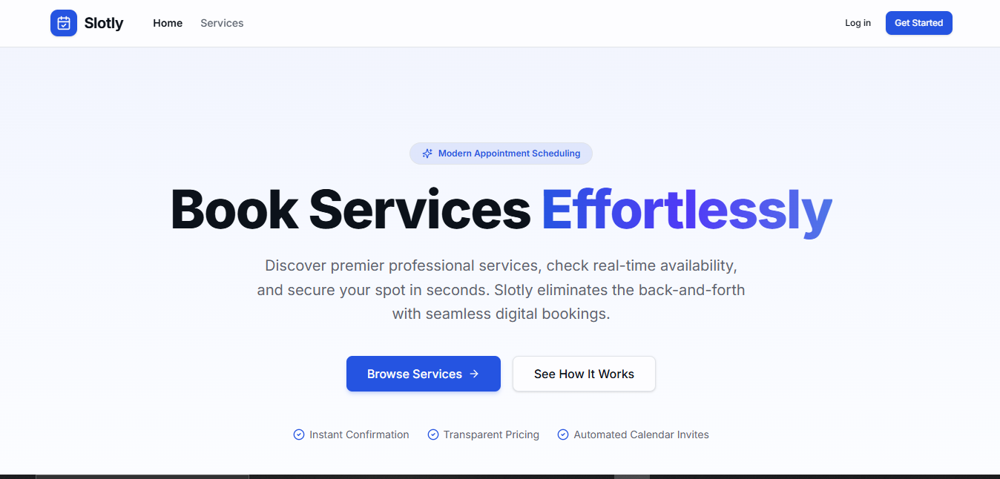
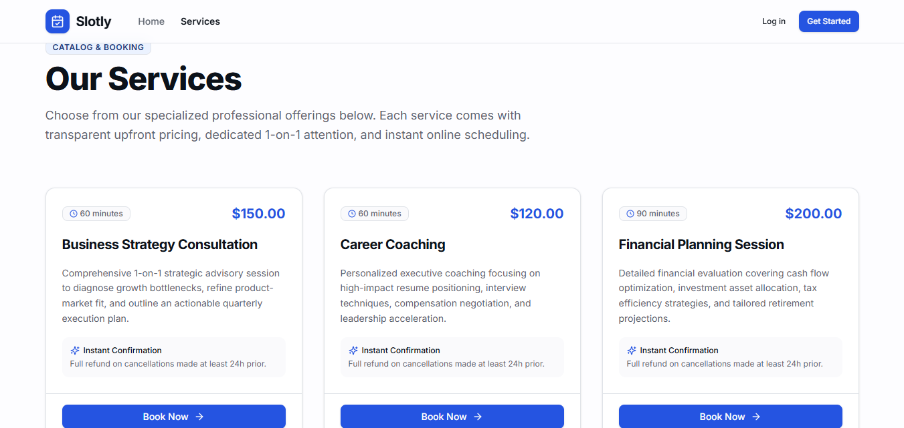
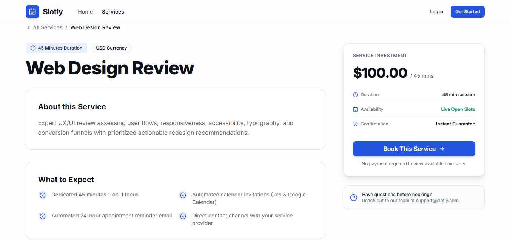
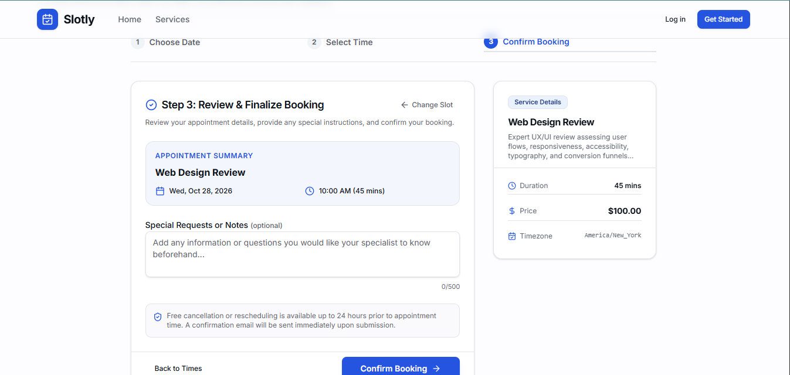
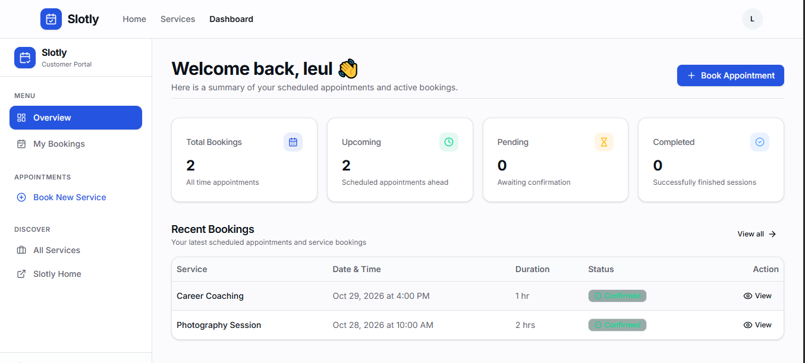
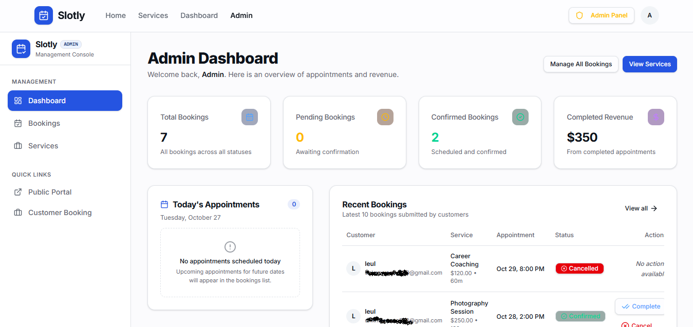
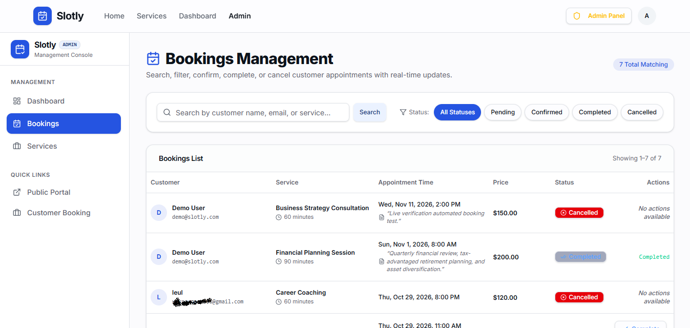

# ⚡ Slotly — Service Booking & Client Portal

[](https://slotly-booking-portal.vercel.app)
[](https://nextjs.org)
[](https://www.typescriptlang.org)
[](https://www.prisma.io)
[](https://neon.tech)
[](https://better-auth.com)
[](https://resend.com)

A modern, full-stack appointment scheduling and service booking platform built with **Next.js 16 (App Router & Turbopack)**, **Prisma ORM**, **Neon PostgreSQL**, **Better Auth**, and **Resend**.

🔗 **Live Deployment**: [https://slotly-booking-portal.vercel.app](https://slotly-booking-portal.vercel.app)

---

## 🌟 Features

### 📅 Booking & Availability Engine
- **Dynamic Slot Generation**: Computes real-time available time slots based on configured business hours, service durations, and existing appointments.
- **Timezone-Aware Calculations**: All scheduling operations strictly calculate in `America/New_York` with UTC storage, ensuring daylight saving time accuracy.
- **Double-Booking Guard**: Multi-layered conflict prevention using both real-time database queries and a database-level unique constraint (`unique_service_time_slot`) to eliminate race conditions.
- **Enforced Cancellation Policy**: Customers can cancel future bookings with automated 24-hour advance deadline enforcement.

### 🔐 Authentication & Role-Based Access Control (RBAC)
- **Better Auth Integration**: Secure session management with HTTP-only cookies (`slotly.session_token`).
- **Cryptographic Hashing**: Scrypt password hashing with unique salts (`salt:hash`).
- **Email Verification**: Required email verification on signup via branded transactional emails.
- **Self-Service Password Reset**: Secure single-use, 1-hour expiration tokens for password recovery.
- **Role-Based Protection**: Dual-layer protection (Next.js middleware and API route handlers) restricting `/admin/*` and administrative mutations to verified administrators.

### 👤 Customer Experience
- **Public Service Catalog**: Browse service offerings with descriptions, duration, pricing, and details.
- **Frictionless Booking Flow**: Multi-step booking form with dynamic calendar picker, available time slots, and notes.
- **Client Portal**: View upcoming, completed, and cancelled appointments with detailed summary pages.

### 🛠️ Administrative Control Center
- **Service Catalog Management**: Create, update pricing, edit duration, and toggle active status or delete services.
- **Bookings Oversight**: Filter bookings by status (`PENDING`, `CONFIRMED`, `COMPLETED`, `CANCELLED`) and service.
- **Status Transitions**: Directly confirm or manage customer bookings.

### ✉️ Transactional Notifications (Resend)
- Automated branded emails for:
  - Account email verification
  - Password reset requests
  - Booking creation confirmation
  - Booking cancellation notices

---

## 📸 Application Screenshots

### 🌐 Public Experience & Service Catalog
| Landing Page | Service Offerings Catalog |
| :---: | :---: |
|  |  |
| *Hero section with value proposition & immediate CTAs* | *Transparent upfront pricing, session durations, and instant booking* |

### 📅 Seamless Appointment Scheduling Flow
| Service Overview & Expectations | Multi-Step Timezone Booking & Review |
| :---: | :---: |
|  |  |
| *Detailed service outline, deliverables, and expectations* | *Timezone-aware dynamic slot selection, client notes, and confirmation* |

### 📊 Client & Administrator Control Centers
| Customer Portal Dashboard | Admin Business & Revenue Oversight |
| :---: | :---: |
|  |  |
| *Client appointment overview, active bookings, and cancellation controls* | *High-level revenue metrics, total bookings, and appointment tracking* |

### 🛠️ Administrative Booking Oversight

*Complete bookings table with real-time status filtering (Pending, Confirmed, Completed, Cancelled) and administrative lifecycle controls.*

---

## 🏗️ Technology Stack

| Layer | Technologies |
| :--- | :--- |
| **Framework** | Next.js 16.4.3 (App Router, Turbopack, React 19) |
| **Language** | TypeScript 5 (Strict Mode) |
| **Database & ORM** | Neon PostgreSQL (Serverless connection pooler) & Prisma ORM 6.4 |
| **Authentication** | Better Auth 1.7 (Admin plugin, Credential provider, Email verification) |
| **Styling & UI** | Tailwind CSS v4, Radix UI Primitives, Lucide Icons, Sonner |
| **Forms & Validation** | React Hook Form & Zod Schema Validation |
| **Email Delivery** | Resend API v4 (HTML templates, verified custom domain) |
| **Testing** | Vitest 3.2 (Unit & Integration) & Playwright (E2E) |
| **Deployment** | Vercel Serverless Platform |

---

## 📁 Project Structure

```text
slotly-booking-portal/
├── prisma/
│   ├── schema.prisma          # Database schema (User, Session, Service, Booking, etc.)
│   └── seed.ts                # Database seeder (business hours, services, admin setup)
├── public/                    # Static assets & SVG icons
├── src/
│   ├── app/
│   │   ├── (admin)/           # Admin dashboard & management routes
│   │   ├── (auth)/            # Auth pages (login, register, verify-email, reset-password)
│   │   ├── (dashboard)/       # Customer dashboard & appointment history
│   │   ├── api/               # Serverless API routes (admin, auth, availability, bookings)
│   │   ├── book/              # Multi-step appointment booking flow
│   │   ├── services/          # Public service catalog & service detail pages
│   │   ├── layout.tsx         # Root layout with navigation & toast providers
│   │   └── page.tsx           # Landing page with featured services & value proposition
│   ├── components/
│   │   ├── admin/             # Admin management components (tables, forms, actions)
│   │   ├── dashboard/         # Customer portal components
│   │   ├── ui/                # Reusable Radix UI & design system components
│   │   ├── booking-form.tsx   # Interactive booking & slot selection component
│   │   └── header.tsx         # Responsive navigation header
│   ├── lib/
│   │   ├── auth.ts            # Server-side Better Auth initialization & callbacks
│   │   ├── auth-client.ts     # Client-side Better Auth hooks & methods
│   │   ├── availability.ts    # Slot calculation engine & business hour logic
│   │   ├── email.ts           # Resend client & responsive HTML email templates
│   │   ├── env.ts             # Typed environment variable validator
│   │   ├── prisma.ts          # Serverless Prisma client singleton
│   │   └── validations/       # Zod schemas (auth, booking, service)
│   ├── middleware.ts          # Edge route protector (session & role verification)
│   └── tests/                 # Vitest test suites & functional verification
├── .env.example               # Sanitized environment variable template
├── next.config.ts             # Next.js production configuration & security headers
├── package.json               # Dependencies, scripts & build lifecycle hooks
└── tsconfig.json              # TypeScript strict configuration
```

---

## 🚀 Getting Started

### Prerequisites
- **Node.js**: v20 or higher
- **PostgreSQL Database**: Neon serverless database (or local PostgreSQL)
- **Resend Account**: For transactional emails (API key and verified domain)

### 1. Clone the Repository
```bash
git clone https://github.com/leul16/slotly-booking-portal.git
cd slotly-booking-portal
```

### 2. Install Dependencies
```bash
npm install
```
*(Prisma Client is automatically generated via the `postinstall` hook).*

### 3. Configure Environment Variables
Copy `.env.example` to create your local `.env`:
```bash
cp .env.example .env
```

Populate the required variables:

| Variable | Description |
| :--- | :--- |
| `DATABASE_URL` | Neon PostgreSQL pooled connection string (`-pooler`, `sslmode=require`) |
| `BETTER_AUTH_SECRET` | Secret key for signing sessions (min 32 characters) |
| `BETTER_AUTH_URL` | Base application URL (e.g. `http://localhost:3000`) |
| `NEXT_PUBLIC_APP_URL` | Public frontend URL for client-side links |
| `RESEND_API_KEY` | Resend API key (`re_...`) |
| `EMAIL_FROM` | Authorized sender address (e.g. `Slotly <noreply@yourdomain.com>`) |
| `ADMIN_SETUP_EMAIL` | Initial admin account email for database seeder |
| `ADMIN_SETUP_PASSWORD`| Initial admin account password for database seeder |

### 4. Database Setup & Seeding
Push the schema to your PostgreSQL database and seed sample data:
```bash
npm run db:push
npm run db:seed
```

### 5. Start the Development Server
```bash
npm run dev
```
Open [http://localhost:3000](http://localhost:3000) in your browser.

---

## 🧪 Testing & Verification

Run the test suite with [Vitest](https://vitest.dev):
```bash
# Run all unit and integration tests
npm test

# Run tests in watch mode
npm run test:watch
```

Run TypeScript strict type checking:
```bash
npm run typecheck
```

Build the production bundle locally:
```bash
npm run build
```

---

## 🚢 Deployment on Vercel

1. Import the repository at [vercel.com/new](https://vercel.com/new).
2. Framework Preset is automatically detected as **Next.js**.
3. Add the environment variables from the table above under **Project Settings > Environment Variables**.
4. Deploy! Vercel compiles all 24 routes with Turbopack and serves the application on global edge nodes.

---

## 🔒 Security Practices

- **Zero Secret Commits**: Local environment files are strictly ignored via `.gitignore`.
- **Database Connection Pooling**: Neon connection pooler prevents connection limits from being exceeded during serverless scaling.
- **CSRF & Origin Verification**: Better Auth trusted origins configured for production domains and preview URLs.
- **Input Sanitization**: All incoming request bodies and query parameters validated against Zod schemas.
- **Security Headers**: Configured in `next.config.ts` (`X-Frame-Options: DENY`, `X-Content-Type-Options: nosniff`, `Referrer-Policy: strict-origin-when-cross-origin`).

---

## 📄 License

This project is licensed under the MIT License.
